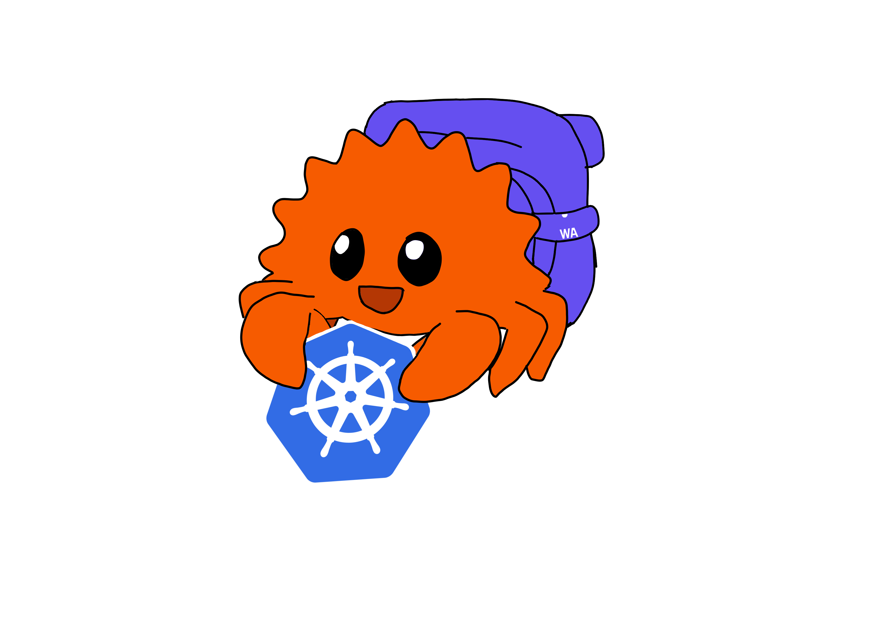
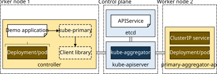

# Master thesis project - Improving event-based Kubernetes controller APIs

<div align="center">
  
</div>

## Overview

This repository contains resources for my master's thesis focused on optimizing Kubernetes operators for edge orchestration using WebAssembly.  
Building on the prototype of Ramlot T. and Van Landuyt K., this project aims to find alternative solutions to wake-up behavior in operators, causing inefficiencies within the WebAssembly-based environment.
The chosen subject was *"Edge Kubernetes with WebAssembly"*, but the project evolved (partially) away from there.

## Background

This is the third instalment in a series of master's theses, where Kubernetes is adapted for orchestration at the edge by making use of WebAssembly.  
It builds on the prior work of Ramlot T. ([Github repo](https://github.com/thesis-2022-wasm-operators/wasm_operator)), who created the prototype, and Van Landuyt K. ([Github repo](https://github.com/kvanla/wasm-operator)), who expanded the prototype with predictive capabilities.

During the development of Van Landuyt's solution, problematic behavior was highlighted in the used operators, where the operators would wake-up in a set interval (this through analysis of the [Percona MongoDB Operator](https://github.com/percona/percona-server-mongodb-operator)).
This is problematic for the WASM prototype, since unloading is used to minimize the operator footprint.
Minimizing the number of wake-ups (i.e. calling the reconciliation function), increases the efficiency of the solution.

### "Accepted" reasons to use scheduled reconciliation

From [Kubebuilder book: Why not use RequeueAfter X for all scenarios instead of watching resources?](https://book.kubebuilder.io/reference/watching-resources.html?highlight=period#why-not-use-requeueafter-x-for-all-scenarios-instead-of-watching-resources):
> While RequeueAfter is not the primary method for triggering reconciliations, there are specific cases where it is necessary, such as:
>
> - **Observing External Systems:** When working with external resources that do not generate events (e.g., external databases or third-party services), RequeueAfter allows the controller to periodically check the status of these resources.
> - **Time-Based Operations:** Some tasks, such as rotating secrets or renewing certificates, must happen at specific intervals. RequeueAfter ensures these operations are performed on schedule, even when no other changes occur.
> - **Handling Errors or Delays:** When managing resources that encounter errors or require time to self-heal, RequeueAfter ensures the controller waits for a specified duration before checking the resource’s status again, avoiding constant reconciliation attempts.

### Other reasons observed in practice

A more extensive rundown on how these reasons were found can be found in the dissertation text.
The drafts for this research can be found in: [findings/investigation_reconcile_percona_mongodb](./thesis_resources/findings/investigation_reconcile_percona_mongodb.md) and [findings/investigation_reconcile_other_operators](./thesis_resources/findings/investigation_reconcile_other_operators.md).
Please note that these were not updated after the initial draft and thus could lack some information or misinterpret others.

1. Batching of volatile data
2. Missing signals
3. Ease-of-use
4. Race conditions

Both 1 and 2 could potentially be solved by using proper specialization, such as is implemented for the metrics API server HPA combination.
These would then fall under the category of "Observing External Systems"

Specifically for the Percona MongoDB operator, these are the final results:

1. In order to support **sidecar containers**
   - These often have the ability to modify the behavior of an application, while not directly modifying the Kubernetes resources, preventing the Reconcile function from being called  
   -> "Observing External Systems"
2. In order to manage the **secondary resources** created when a CR is initialized
   - Doing this properly would involve setting up the correct watches, referencing the CR object and making sure the event filtering (through the use of predicates) is up to snuff  
   -> Ease-of-use

## Project structure

### Deployment diagram

<picture>
  <source media="(prefers-color-scheme: dark)" srcset="./attachments/deployment-diagram-dark.svg">
  <source media="(prefers-color-scheme: light)" srcset="./attachments/deployment-diagram-light.svg">
  
</picture>

### External resources

- [Github](https://github.com/idlab-discover/wasm-operator): repository of the official WASM operator project

All information is included in this repository. Everything relevant to the prototype will later be upstreamed to the WASM operator project.

### Internal folder structure

```text
+-- 📂 experiments                                   # Projects created for learning / testing, not directly related to PoC
|   +-- 📂 cronjob-tutorial                          # Kubebuilder tutorial: "Building cronjob".
|   |   +-- 📂 kube-rs                               # Naive translation of tutorial to Kube.rs.
|   |   +-- 📂 kubebuilder                           # Kubebuilder implementation of tutorial.
|   +-- 📂 mongodb_event_creator                     # CLI application for spamming a MongoDB cluster with reads and writes
+-- 📂 poc                                           # Main project, organized as a Cargo workspace
|   +-- 📂 benchmark                                 # CLI application for setting up and testing the latency of the PoC
|   |   +-- 📂 terraform-gke-cluster                 # Terraform files used to setup the GKE testing cluster
|   |   +-- 📂 results                               # Raw results + plots gathered from the four testing environments
|   +-- 📂 demo-controller                           # Archived demo project mimicking the Percona MongoDB operator for verifying API
|   +-- 📂 kube-primary                              # Extension library to Kube.rs for enforcing linking and integration with extension API server
|   +-- 📂 primary-aggregator-api                    # Extension API server using the linking for batching primary + secondary requests
+-- 📂 thesis_resources                              # Resources and documentation specific to the thesis project.
|   +-- 📂 findings                                  # Research findings and analyses from the project.
|   +-- 📂 investigation_reconcile_percona_mongodb   # Resources used in investigation scheduled reconciliation MongoDB operator
|   +-- 📂 meeting_notes                             # Summaries from bi-weekly thesis meetings.
```

> [!NOTE]
> Meeting notes will often contain duplicate information. It is mostly used for tracking purposes.  
> The discussed topics are filtered and written down more thoroughly in the other parts of the project.
>
> The internal folder structure above does not contain every folder used in the project.
> The list is limited to the ones that should be immediately accessible to those searching.

### Planning

#### Semester 1

| Period | Tasks |
| ------ | ----- |
| 27/09 - 07/10 | <ul><li>Go through previous master theses</li><li>Research what operators do when activated</li><li>Investigate how events work on client and server side and why these are not enough for the WASM-operator</li></ul> |
| 07/10 - 21/10 | <ul><li>Analyze Van Landuyt's K.'s operators for the wake-up behavior by investigating the code and traces</li></ul> |
| 21/10 - 04/11 | <ul><li>Analyze Van Landuyt's K.'s operators for the wake-up behavior by investigating the code and traces</li><li>Compare the operator(/controller) architecture from Kubebuilder with kube.rs</li></ul> |
| 04/11 - 18/11 | <ul><li>Compare the operator(/controller) architecture from Kubebuilder with kube.rs</li><li>Investigate how scheduled reconciliation is implemented and why</li></ul> |
| 18/11 - 02/12 | <ul><li>Run the WASM-prototype locally and investigate further</li><li>Find which parts of the Percona MongoDB operator enforce the use of scheduled reconciliation</li><li>Continue learning Kube.rs</li></ul> |
| 02/12 - 11/12 | <ul><li>Work toward prototype solution</li><li>Work on presentation</li><li>Create first draft of thesis</li><li>Add documentation to WASM operator (formatting, linting, and usage)</li></ul> |
| 11/12 - 19/12 | <ul><li>Implement automatic watches in PoC</li><li>Implement feedback presentation</li><li>Create first draft of thesis</li></ul> |

#### Semester 2

| Period | Tasks |
| ------ | ----- |
| 10/02 - 24/02 | <ul><li>Implement automatic watches in PoC</li></ul> |
| 24/02 - 10/03 | <ul><li>Update build process of WASM operator</li><li>Add CI pipeline</li><li>Restructure PoC to use workspace</li></ul> |
| 10/03 - 24/03 | <ul><li>Generalize watches</li><li>Finish automatic watches / linking</li><li>Start work on extension API server</li></ul> |
| 24/03 - 11/04 | <ul><li>Finish extension API server</li><li>Integrate into extension library</li></ul> |
| 11/04 - 24/04 | <ul><li>Add small integration tests</li><li>Simplify API</li><li>Shift focus to writing dissertation</li></ul> |
| 24/04 - 08/05 | <ul><li>Write dissertation</li></ul> |
| 08/05 - 20/05 | <ul><li>Rename projects to be more descriptive</li><li>Handle dependencies using workspaces + update</li><li>Write dissertation</li></ul> |
| 20/05 - 28/05 | <ul><li>Create benchmarking application</li><li>Final proofread + submission</li></ul> |

## Copyright

This project is released under the Apache License Version 2.0.
